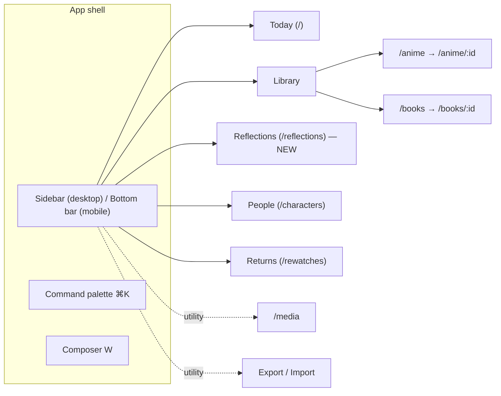

# Lamplight — Premium Journal Redesign

| Field | Value |
|-------|-------|
| **Branch** | `design/premium-journal-redesign` |
| **Date** | 2026-10-30 |
| **Status** | Draft. Waiting for owner review before Phase 0 |
| **Scope** | `Frontend/` only. Django/DRF contract unchanged (every flow below uses existing endpoints) |
| **Supersedes** | Builds on `ui_ux_redesign.md` (Still & Spine), `dashboard-desk-redesign-plan.md`, `detail-page-redesign/`. Keeps their palette DNA and replaces their layouts. |

## Why this plan exists

The owner (also the developer) finds the app confusing to look at and to use. Earlier redesigns improved the colors and typography one page at a time, but the overall experience still feels like several separate tools:

- **The journal's main action leads somewhere else.** "Write Entry" opens *Log New Anime Franchise*, a catalog form. No single place lets you write a reflection about something.
- **Reflections are hidden.** Character `why` sits behind a "Reflection" link. The Reading Room is a modal. Book lessons are small italic quotes under progress bars.
- **Missing covers dominate the screen.** None of the titles have an image, so the Anime grid is mostly 500px tall empty posters and the Characters page is mostly giant sparkle icons.
- **Navigation is flat and breaks on mobile.** Six equal tabs, with Media (a utility) next to journal sections. On a 390px screen the header wraps into a 360px block with a cut-off scrolling tab strip.
- **Pages don't share a pattern.** Each page has its own header, filters, cards, and modal style. Detail pages stack six sections at the same visual weight and repeat the title three times.

See [audit.md](./audit.md) for the full findings for each page, with screenshots.

## The direction: *Lamplight*

> A private reading room at night. One warm lamp, a stack of covers, and paper where your thoughts live.

Three principles decide every layout question:

1. **Words first, catalog second.** Every surface shows the reflection (`notes` / `why` / episode `note`) before status, genre, or counts. A title without words shows an inviting "write what stayed" slot, not a blank.
2. **One gesture to write.** From any page, `W` or the Write button opens the **Composer**. You pick what you're reflecting on, then write on paper. It saves with `⌘↵`. Catalog forms are a secondary path.
3. **Calm by default, rich on intent.** Pages rest quietly with few borders, few chips, and one accent. Detail appears on hover, focus, or expand. Motion confirms actions and never decorates.

Palette DNA stays (walnut night + tea-paper + tungsten). We remove clutter, not identity. Full spec: [design-system.md](./design-system.md).

## New information architecture

| Change | Why |
|--------|-----|
| Sidebar on desktop, bottom tab bar + center **Write** button on mobile | Fixes the broken mobile header. Groups sections by meaning. |
| **Reflections** becomes a page (was the Reading Room modal) | Gives you one place to reread and search everything you wrote. Built only from data the app already loads. |
| Media and Export move into the sidebar's utility group | They're tools, not journal sections. |
| `⌘K` palette: jump to any title, run actions ("update progress on Frieren", "write about Erwin") | Speeds up navigation and makes the app usable from the keyboard. |
| Routes `/`, `/anime`, `/books`, `/characters`, `/rewatches`, `/media` keep their URLs | Existing links and the dev workflow keep working. |

## Phases

Each phase can ship on its own, leaves the app working, and gets a desktop and mobile screenshot check. Details, files, and acceptance criteria: [implementation.md](./implementation.md). Page specs: [pages.md](./pages.md).

| # | Phase | Outcome |
|---|-------|---------|
| 0 | **Foundations** | Tokens v2, split CSS, UI primitives (`Button`, `Chip`, `StatusMark`, `Rating`, `Cover`, `Sheet`, `EmptyState`, `Skeleton`), status label map (fixes raw `PLAN_TO_READ` text), generated covers |
| 1 | **Shell & navigation** | `JournalProvider` (state and actions out of the 999-line `App.tsx`), sidebar, mobile bottom bar, command palette, route transitions |
| 2 | **Composer** | One writing flow for lessons, episode memories, returns, and character `why`. Autosaved drafts. |
| 3 | **Today (Desk)** | Continue row, resurfaced memory, "waiting for words" nudges, recent reflections |
| 4 | **Library** | Shared layout for Anime and Books: toolbar, shelf/list toggle, sorting, lesson excerpts on cards |
| 5 | **Detail pages** | Two-column folio: sticky identity on one side, release switcher plus inline-editable reflection on the other, episode grid, then-vs-now returns |
| 6 | **Reflections, People, Returns** | New Reflections page, portrait wall, then→now return timeline |
| 7 | **Forms & utilities** | Catalog forms restyled in steps, Media and Export tidied, side-sheet detail views |
| 8 | **Polish & QA** | Motion pass, a11y audit, responsive QA, code splitting, optional Day (paper) theme |

## Decisions to confirm before Phase 0

1. **Dark only, or add a light "Day" theme?** Recommended: refined dark first. Day theme as optional Phase 8 (tokens are built for it from Phase 0).
2. **Add the `/reflections` page?** Recommended: yes. It's the most direct way to support reflection.
3. **Sidebar instead of the top bar?** Recommended: yes on desktop ≥ 1024px. Mobile gets the bottom bar either way.
4. **Refactor `App.tsx` into a context provider?** Recommended: yes, with no change in behavior. The Composer and palette need actions available everywhere.

## Out of scope

- Model, serializer, or URL changes. If a phase finds a real gap, it stops and raises it rather than changing the backend.
- New models (quotes, tags, highlights), per root `AGENTS.md`.
- Stock or mock imagery as default covers. Generated covers replace placeholders.

